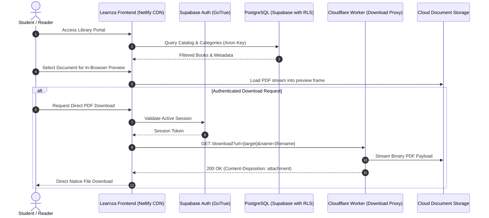

# learnza

[](https://github.com/itsgoharrehman/learnza/releases/tag/v1.0.0) [](https://developer.mozilla.org/en-US/docs/Web/JavaScript) [](https://supabase.com) [](https://workers.cloudflare.com) [](https://www.netlify.com) [](LICENSE)

An open-source, high-performance digital e-library platform designed for seamless document discovery, real-time catalog search, in-browser PDF previews, and edge-proxied document streaming.

Built without heavy JavaScript frameworks, Learnza delivers instant First Contentful Paint (FCP) by coupling vanilla ES6+ web standards with Supabase for relational data storage and user authentication, Netlify for global CDN delivery, and Cloudflare Workers for edge-based cross-origin attachment streaming.

---

## Architectural Overview

Learnza coordinates static client execution, managed relational storage, and serverless edge functions:



---

## Key Capabilities

* **Relational Book Catalog**: Real-time category filtering, full-text title and author search indexing, and pagination powered directly by PostgreSQL queries.
* **In-Browser Document Previewer**: Dedicated viewer interface (`preview.html`) allowing immediate inline reading before downloading.
* **Edge Streaming Proxy**: Cloudflare Worker microservice resolving browser CORS constraints and enforcing attachment streaming headers for external storage hosts.
* **Administrative Management Portal**: Authenticated admin console (`admin.html`) for managing categories, uploading document metadata, and monitoring catalog assets.
* **Zero Framework Bloat**: Pure vanilla HTML5, CSS3, and ES6+ JavaScript ensuring high audit scores, minimal memory footprint, and sub-second load times.

---

## Repository Structure

```
learnza/
├── .github/
│   ├── ISSUE_TEMPLATE/
│   │   ├── bug_report.yml          # Structured bug reporting form
│   │   └── feature_request.yml     # Structured feature request form
│   ├── PULL_REQUEST_TEMPLATE.md    # Pull request verification checklist
│   └── dependabot.yml              # Automated weekly dependency scanner
├── assets/
│   └── logo.svg                    # Brand vector asset
├── css/
│   ├── admin.css                   # Administrative portal styles
│   └── styles.css                  # Core application styling and dark/light system
├── db/
│   └── database_setup.sql          # PostgreSQL schemas, tables, and RLS policies
├── js/
│   ├── admin.js                    # Admin catalog actions and form listeners
│   ├── config.js                   # Application endpoint and key configuration
│   ├── contact.js                  # Contact form feedback submission handler
│   ├── downloader.js               # Cloudflare Worker streaming client interface
│   ├── main.js                     # Catalog filtering, search, and dynamic cards
│   ├── notesapi.js                 # API wrapper for book and notes metadata
│   ├── preview.js                  # Document viewer integration
│   ├── supabaseclient.js           # Supabase client instantiation
│   └── utils.js                    # DOM helpers, sanitizers, and formatters
├── about.html                      # Project background and mission
├── admin.html                      # Authenticated catalog management interface
├── contact.html                    # User feedback and support page
├── download.html                   # Dedicated file download progress handler
├── index.html                      # Primary digital library catalog portal
├── preview.html                    # In-browser document viewer
├── privacy.html                    # Privacy policy documentation
├── wrangler.jsonc                  # Cloudflare Worker edge configuration
├── package.json                    # Project metadata and local tooling scripts
├── LICENSE                         # MIT License
├── SECURITY.md                     # Security policy and vulnerability disclosure
├── CONTRIBUTING.md                 # Contribution guidelines
└── CODE_OF_CONDUCT.md             # Contributor Covenant v2.1
```

---

## Database Architecture and RLS Policies

All library data is stored in PostgreSQL and secured with Row-Level Security (RLS) via `db/database_setup.sql`:

```sql
-- Public catalog reading policy
ALTER TABLE public.books ENABLE ROW LEVEL SECURITY;

CREATE POLICY "Public users can view catalog books"
ON public.books FOR SELECT
USING (true);

-- Authenticated administrator management policy
CREATE POLICY "Admins can insert and modify books"
ON public.books FOR ALL
TO authenticated
USING (auth.jwt() ->> 'role' = 'catalog_admin');
```

---

## Configuration Reference

Application settings are managed in `js/config.js`:

| Variable | Description | Security Scope |
| :--- | :--- | :--- |
| `SUPABASE_URL` | Supabase project API endpoint URL | Public (Client Bundle) |
| `SUPABASE_ANON_KEY` | Supabase public anonymous access key | Public (Restricted via RLS) |
| `WORKER_DOWNLOAD_URL` | Deployed Cloudflare Worker streaming proxy URL | Public |

> [!CAUTION]
> Never expose the Supabase `service_role` key in client-side code or configuration files. The client bundle must exclusively use the anonymous (`anon`) public key.

---

## Local Development

### Prerequisites

* Modern web browser with ES6 module support
* Node.js v18+ (for local HTTP server and Wrangler CLI)

### Setup

1. Clone the repository:
   ```bash
   git clone https://github.com/itsgoharrehman/learnza.git
   cd learnza
   ```

2. Install local development tooling:
   ```bash
   npm install
   ```

3. Configure credentials:
   Edit `js/config.js` with your Supabase project URL and anon public key.

4. Start the local development server:
   ```bash
   npm start
   ```
   Navigate to `http://localhost:3000` in your browser.

5. Test the Cloudflare Worker locally:
   ```bash
   npm run dev
   ```

---

## Security and Governance

* **Vulnerability Reporting**: See [SECURITY.md](SECURITY.md) for vulnerability disclosure procedures.
* **Contributing**: Read [CONTRIBUTING.md](CONTRIBUTING.md) for code standards and pull request workflows.
* **Code of Conduct**: Community standards are defined in [CODE_OF_CONDUCT.md](CODE_OF_CONDUCT.md).

---

## License

This project is licensed under the terms of the [MIT License](LICENSE).
